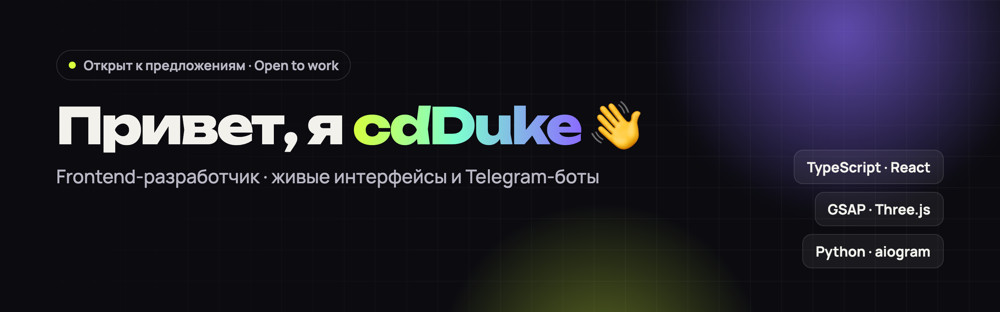

**Frontend-разработчик.** Делаю анимированные сайты, React-приложения и Telegram-ботов на Python. 
*Frontend developer — animated websites, React apps and Python Telegram bots.*

## 🖥 Сайты и приложения

Каждый проект — с живым демо, адаптивом под телефон и версиями на русском и английском.

<table>
<tr>
<td width="33%" valign="top">

 <b>Nova Studio</b> Сайт креативного агентства <code>GSAP · Lenis</code> 
<a href="https://cdduke.github.io/nova-studio/">▶ Демо</a> · <a href="https://github.com/cdDuke/nova-studio">Код</a>
</td>
<td width="33%" valign="top">

 <b>Orbit</b> SaaS-лендинг с 3D-глобусом на шейдерах <code>Three.js · GLSL · TS</code> 
<a href="https://cdduke.github.io/orbit-saas/">▶ Демо</a> · <a href="https://github.com/cdDuke/orbit-saas">Код</a>
</td>
<td width="33%" valign="top">

 <b>TaskFlow</b> Канбан с drag & drop и undo <code>React · Zustand · dnd-kit</code> 
<a href="https://cdduke.github.io/taskflow-kanban/">▶ Демо</a> · <a href="https://github.com/cdDuke/taskflow-kanban">Код</a>
</td>
</tr>
<tr>
<td width="33%" valign="top">

 <b>Kvartal</b> Недвижимость: карта, планировки, ипотека <code>React · TypeScript</code> 
<a href="https://cdduke.github.io/kvartal-estate/">▶ Демо</a> · <a href="https://github.com/cdDuke/kvartal-estate">Код</a>
</td>
<td width="33%" valign="top">

 <b>SkyCast</b> Погода с живым фоном (Open-Meteo) <code>React · Canvas · API</code> 
<a href="https://cdduke.github.io/skycast-weather/">▶ Демо</a> · <a href="https://github.com/cdDuke/skycast-weather">Код</a>
</td>
<td width="33%" valign="top">

 <b>Savor</b> Ресторан: меню, дегустация, бронь <code>GSAP SplitText · DrawSVG</code> 
<a href="https://cdduke.github.io/savor-restaurant/">▶ Демо</a> · <a href="https://github.com/cdDuke/savor-restaurant">Код</a>
</td>
</tr>
<tr>
<td width="33%" valign="top">

 <b>Voyage</b> Турагентство с генеративными пейзажами <code>React · Motion</code> 
<a href="https://cdduke.github.io/voyage-travel/">▶ Демо</a> · <a href="https://github.com/cdDuke/voyage-travel">Код</a>
</td>
<td width="33%" valign="top">

 <b>Pulse</b> Лендинг фитнес-приложения <code>GSAP · CSS-макет</code> 
<a href="https://cdduke.github.io/pulse-fitness/">▶ Демо</a> · <a href="https://github.com/cdDuke/pulse-fitness">Код</a>
</td>
<td width="33%" valign="top">

 <b>Luma Coffee</b> Магазин кофе с корзиной <code>GSAP · Vite</code> 
<a href="https://cdduke.github.io/luma-coffee/">▶ Демо</a> · <a href="https://github.com/cdDuke/luma-coffee">Код</a>
</td>
</tr>
</table>

## 🤖 Telegram-боты

<table>
<tr>
<td width="33%" valign="top">

 <b>ServerEye</b> Мониторинг серверов: ping/HTTP/TCP, uptime, графики <a href="https://github.com/cdDuke/servereye-bot">Код</a>
</td>
<td width="33%" valign="top">

 <b>Карманный Адвокат</b> AI-юрист для РФ и КЗ: OCR, претензии в DOCX/PDF <a href="https://github.com/cdDuke/karmanny-advokat-bot">Код</a>
</td>
<td width="33%" valign="top">

 <b>LoveIS</b> AI-помощник для отношений <a href="https://github.com/cdDuke/loveis-bot">Код</a>
</td>
</tr>
</table>

## ✨ Что для меня важно

- **Живой интерфейс** — продуманная анимация (GSAP, ScrollTrigger, Motion), плавный скролл, отклик на каждое действие
- **Адаптив** — каждый проект проверен на экранах 390, 820 и 1440 px
- **Доступность** — клавиатура, ARIA, `prefers-reduced-motion`
- **Без шаблонов** — иллюстрации нарисованы кодом: SVG, Canvas, WebGL-шейдеры
