


 

## 👋 Обо мне · About me

<table>
<tr>
<td valign="top" width="52%">

🎨 **Frontend-разработчик**: делаю интерфейсы, которые ощущаются живыми — анимации, 3D, плавный скролл 
⚛️ Пишу на **React + TypeScript**, собираю на **Vite**, анимирую на **GSAP** и **Three.js** 
🤖 Делаю **Telegram-ботов** на Python (aiogram 3) — от мониторинга серверов до AI-юриста 
🧠 Подключаю **AI**: OpenAI-совместимые API, OCR, генерация документов 
🌍 Каждый проект — **адаптив** под телефон и **две языковые версии** (RU / EN) 
🎯 Открыт к **работе в команде** и **фриланс-проектам**

🇬🇧 Frontend developer building lively interfaces — animation, 3D/WebGL, React apps — and Python Telegram bots with AI features. Every project ships with a live demo, mobile layout and RU/EN. Open to full-time roles and freelance.

</td>
<td valign="top" width="48%">


</td>
</tr>
</table>


## 🧠 Что умею · What I do

<table>
<tr>
<td valign="top" width="50%">

#### 🎬 Анимации и моушн
GSAP (ScrollTrigger, SplitText, DrawSVG), Motion, Lenis, CSS-анимации, интро и скролл-сторителлинг — с уважением к `prefers-reduced-motion`

</td>
<td valign="top" width="50%">

#### 🪐 3D и графика
Three.js и собственные GLSL-шейдеры, Canvas 2D (частицы, дождь, снег), процедурный SVG: пейзажи, блюда, фасады и планировки нарисованы кодом

</td>
</tr>
<tr>
<td valign="top">

#### ⚛️ React-приложения
React 19 + TypeScript strict, Zustand, dnd-kit, состояние в URL, формы с валидацией, undo-история, тёмная тема без мигания

</td>
<td valign="top">

#### 🔌 Работа с API
REST (Open-Meteo), автодополнение с debounce и AbortController, пакетные запросы, скелетоны и понятные экраны ошибок

</td>
</tr>
<tr>
<td valign="top">

#### 🤖 Telegram-боты
aiogram 3, FSM-сценарии, middlewares, планировщик задач, SQLAlchemy + SQLite, админ-панели, рассылки, деплой через systemd

</td>
<td valign="top">

#### 🧠 AI-интеграции
OpenAI-совместимые API, промпты под предметную область, OCR (Tesseract), генерация DOCX и PDF

</td>
</tr>
<tr>
<td valign="top">

#### ♿ Качество
Адаптив 390–1440 px, доступность (ARIA, клавиатура, скринридеры), i18n RU/EN, автопроверка в headless Chrome

</td>
<td valign="top">

#### 🚀 Сборка и деплой
Vite, ленивая загрузка тяжёлых модулей, GitHub Actions → GitHub Pages, секреты только в `.env`

</td>
</tr>
</table>

## 🛠 Стек · Tech stack

**Frontend** 

**Motion & 3D** 

**State & quality** 

**Bots & backend** 

**AI** 

**Tools** 

## 🚀 Проекты · Projects

> Все веб-проекты открываются прямо в браузере — кнопка **▶ Демо**. Код и подробный README — по ссылке **📦 Код**.

### ⚡ Веб-приложения

<table>
<tr>
<td valign="top" width="50%">

<a href="https://cdduke.github.io/taskflow-kanban/">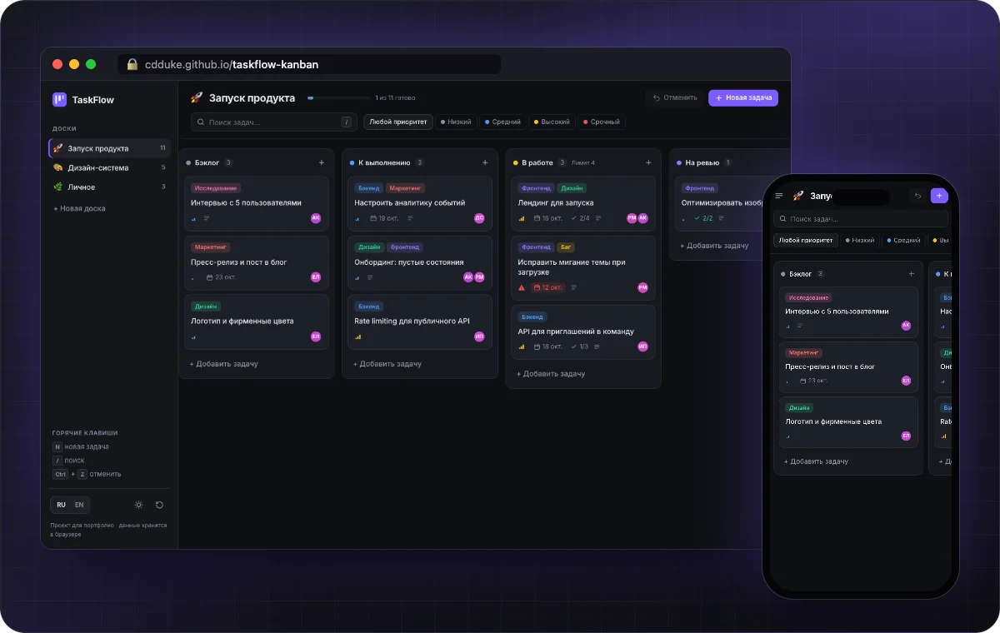</a>

### 🗂 [TaskFlow](https://github.com/cdDuke/taskflow-kanban)
Канбан-доски в духе Linear/Trello: drag & drop мышью, пальцем и с клавиатуры (с озвучкой для скринридеров), карточка задачи с чек-листом, отмена на 40 шагов, тёмная и светлая тема без мигания. 
`React 19` `TypeScript` `Zustand` `dnd-kit` 
<a href="https://cdduke.github.io/taskflow-kanban/"><b>▶ Демо</b></a> · <a href="https://github.com/cdDuke/taskflow-kanban">📦 Код</a>

</td>
<td valign="top" width="50%">

<a href="https://cdduke.github.io/kvartal-estate/">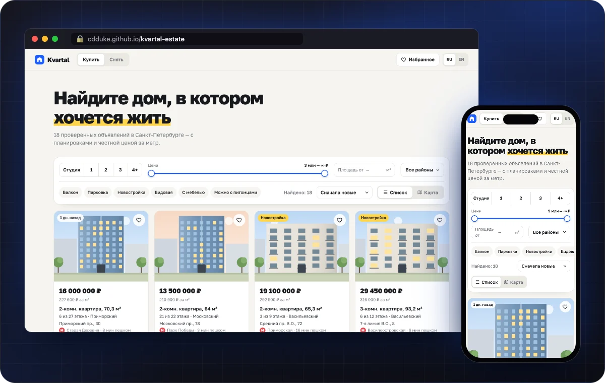</a>

### 🏙 [Kvartal](https://github.com/cdDuke/kvartal-estate)
Сервис поиска квартир: фильтры синхронизируются с URL, SVG-карта города с метками цен, генератор планировок, ипотечный калькулятор, сравнение до трёх объектов. 
`React 19` `TypeScript` `SVG` `URL state` 
<a href="https://cdduke.github.io/kvartal-estate/"><b>▶ Демо</b></a> · <a href="https://github.com/cdDuke/kvartal-estate">📦 Код</a>

</td>
</tr>
<tr>
<td valign="top" width="100%" colspan="2">

<a href="https://cdduke.github.io/skycast-weather/">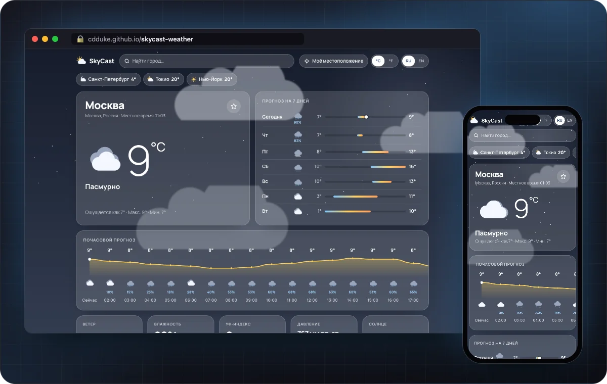</a>

### 🌦 [SkyCast](https://github.com/cdDuke/skycast-weather)
Погода на реальном API Open-Meteo: поиск городов с автодополнением (debounce + AbortController), геолокация, почасовой график, прогноз на 7 дней, живой фон на Canvas — дождь, снег, молнии. 
`React 19` `TypeScript` `REST API` `Canvas` 
<a href="https://cdduke.github.io/skycast-weather/"><b>▶ Демо</b></a> · <a href="https://github.com/cdDuke/skycast-weather">📦 Код</a>

</td>
</tr>
</table>

### 🎨 Сайты и лендинги

<table>
<tr>
<td valign="top" width="50%">

<a href="https://cdduke.github.io/orbit-saas/">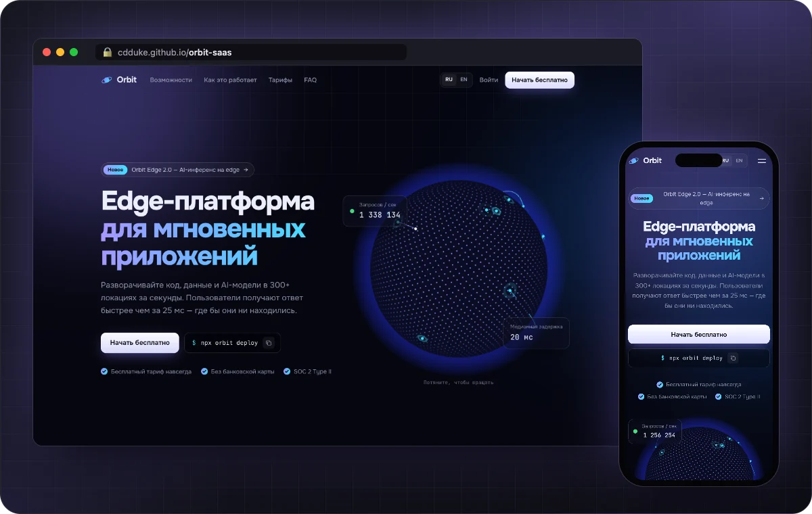</a>

### 🪐 [Orbit](https://github.com/cdDuke/orbit-saas)
Лендинг SaaS-платформы: 3D-глобус на Three.js с собственными GLSL-шейдерами и дугами запросов, «живая» bento-сетка, подсветка кода, тарифы. Тяжёлый 3D-модуль грузится лениво. 
`Three.js` `GLSL` `TypeScript` `GSAP` 
<a href="https://cdduke.github.io/orbit-saas/"><b>▶ Демо</b></a> · <a href="https://github.com/cdDuke/orbit-saas">📦 Код</a>

</td>
<td valign="top" width="50%">

<a href="https://cdduke.github.io/nova-studio/">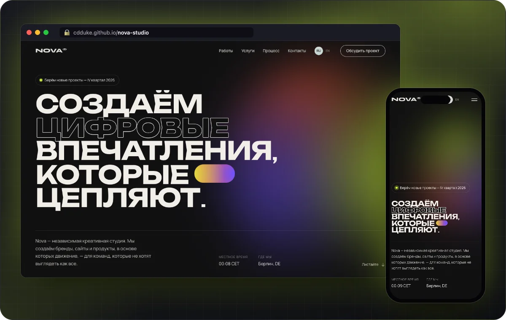</a>

### ✦ [Nova Studio](https://github.com/cdDuke/nova-studio)
Сайт digital-агентства: кастомный курсор, магнитные кнопки, горизонтальный скролл кейсов, бегущая строка, побуквенные появления и плавный скролл. 
`GSAP` `ScrollTrigger` `Lenis` `Vite` 
<a href="https://cdduke.github.io/nova-studio/"><b>▶ Демо</b></a> · <a href="https://github.com/cdDuke/nova-studio">📦 Код</a>

</td>
</tr>
<tr>
<td valign="top" width="50%">

<a href="https://cdduke.github.io/savor-restaurant/">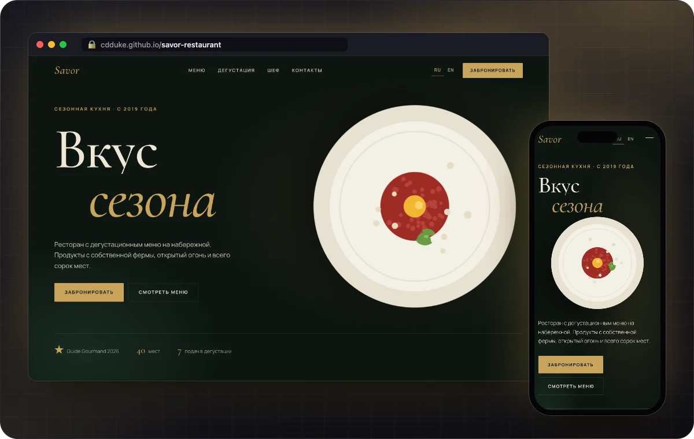</a>

### 🍽 [Savor](https://github.com/cdDuke/savor-restaurant)
Ресторан высокой кухни: интро с DrawSVG, SplitText-анимации, меню с 3D-превью блюд (все блюда нарисованы кодом), таймлайн дегустации, бронирование столика со слотами. 
`GSAP` `SplitText` `DrawSVG` `TypeScript` 
<a href="https://cdduke.github.io/savor-restaurant/"><b>▶ Демо</b></a> · <a href="https://github.com/cdDuke/savor-restaurant">📦 Код</a>

</td>
<td valign="top" width="50%">

<a href="https://cdduke.github.io/voyage-travel/">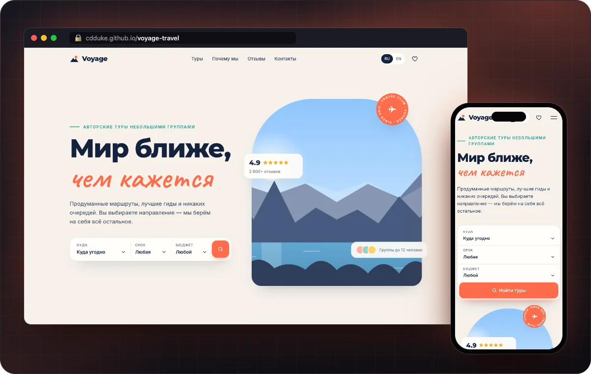</a>

### 🧭 [Voyage](https://github.com/cdDuke/voyage-travel)
Турагентство на React: пейзажи генерируются кодом, фильтры и сортировка с анимацией раскладки, избранное, карточка тура и бронирование с валидацией. 
`React 19` `Motion` `TypeScript` `SVG` 
<a href="https://cdduke.github.io/voyage-travel/"><b>▶ Демо</b></a> · <a href="https://github.com/cdDuke/voyage-travel">📦 Код</a>

</td>
</tr>
<tr>
<td valign="top" width="50%">

<a href="https://cdduke.github.io/pulse-fitness/">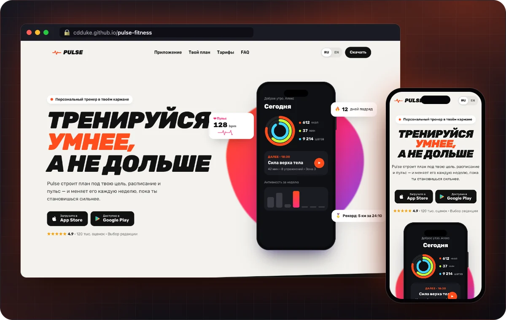</a>

### 💓 [Pulse](https://github.com/cdDuke/pulse-fitness)
Лендинг фитнес-приложения: телефон собран на CSS с живым интерфейсом, закреплённый скролл-сторителлинг, интерактивный генератор плана тренировок. 
`GSAP` `CSS` `TypeScript` `Lenis` 
<a href="https://cdduke.github.io/pulse-fitness/"><b>▶ Демо</b></a> · <a href="https://github.com/cdDuke/pulse-fitness">📦 Код</a>

</td>
<td valign="top" width="50%">

<a href="https://cdduke.github.io/luma-coffee/">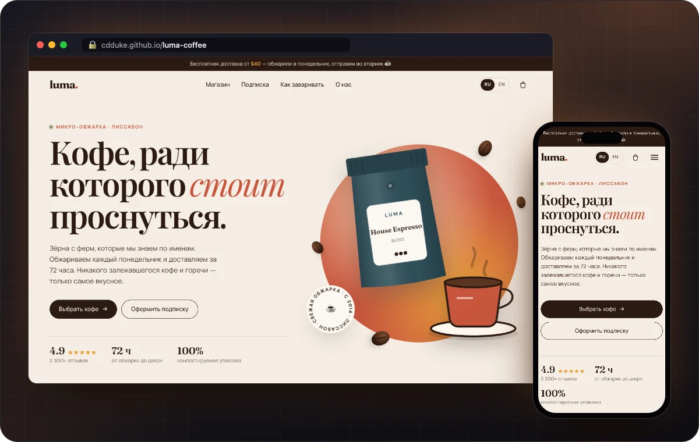</a>

### ☕ [Luma Coffee](https://github.com/cdDuke/luma-coffee)
Магазин specialty-кофе: фильтры по обжарке, карточки с наклоном, корзина с полётом товара, гид по завариванию с таймером, калькулятор подписки. 
`GSAP` `JavaScript` `SVG` `Vite` 
<a href="https://cdduke.github.io/luma-coffee/"><b>▶ Демо</b></a> · <a href="https://github.com/cdDuke/luma-coffee">📦 Код</a>

</td>
</tr>
</table>

### 🤖 Telegram-боты

<table>
<tr>
<td valign="top" width="33%">

<a href="https://github.com/cdDuke/servereye-bot">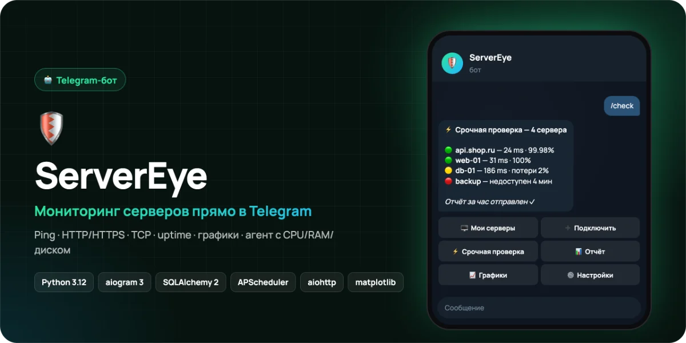</a>

### 🛡 [ServerEye](https://github.com/cdDuke/servereye-bot)
Мониторинг серверов в Telegram: проверки ping/HTTP/TCP, uptime и статистика, графики, ежечасные отчёты, тревоги при падении, агент с CPU/RAM/диском, деплой через systemd. 
`Python` `aiogram 3` `SQLAlchemy` `APScheduler` 
<a href="https://github.com/cdDuke/servereye-bot">📦 Код</a>

</td>
<td valign="top" width="33%">

<a href="https://github.com/cdDuke/karmanny-advokat-bot">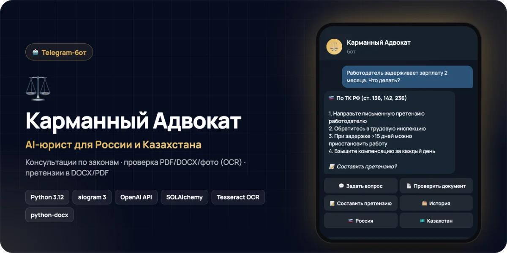</a>

### ⚖️ [Карманный Адвокат](https://github.com/cdDuke/karmanny-advokat-bot)
AI-юрист для России и Казахстана: ответы по законам выбранной страны, проверка PDF/DOCX/фото через OCR, претензии в DOCX/PDF, история обращений, админ-панель с рассылкой. 
`Python` `aiogram 3` `OpenAI API` `Tesseract` 
<a href="https://github.com/cdDuke/karmanny-advokat-bot">📦 Код</a>

</td>
<td valign="top" width="33%">

<a href="https://github.com/cdDuke/loveis-bot">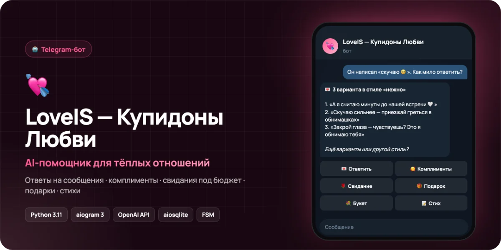</a>

### 💘 [LoveIS](https://github.com/cdDuke/loveis-bot)
AI-помощник для пар: три варианта ответа на сообщение в нужном стиле, комплименты, свидания под бюджет, подарки своими руками, букеты и стихи. 
`Python` `aiogram 3` `OpenAI API` `SQLite` 
<a href="https://github.com/cdDuke/loveis-bot">📦 Код</a>

</td>
</tr>
</table>

### 🌐 Сайт-портфолио · [cdduke.github.io ↗](https://cdduke.github.io)

<a href="https://cdduke.github.io">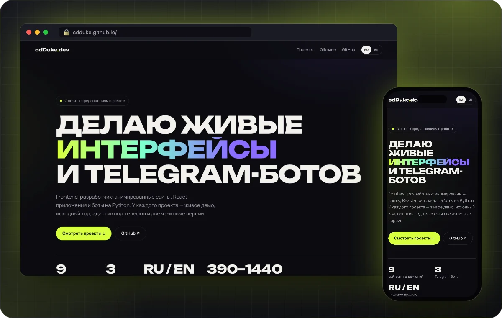</a>

Все проекты на одной странице: фильтр по типу, живые демо, RU/EN. Одна HTML-страница без сборки. 
`HTML5` `CSS3` `JavaScript` `GitHub Pages`

## 🐍 Активность · Activity

<picture>
  <source media="(prefers-color-scheme: dark)" srcset="https://raw.githubusercontent.com/cdDuke/cdDuke/output/github-snake-dark.svg">
  <source media="(prefers-color-scheme: light)" srcset="https://raw.githubusercontent.com/cdDuke/cdDuke/output/github-snake.svg">
  
</picture>

## 📬 Связаться · Contact

| | |
|---|---|
| 🌐 Сайт · Website | [cdduke.github.io](https://cdduke.github.io) |
| 🐙 GitHub | [@cdDuke](https://github.com/cdDuke) |

cdDuke<b>.</b> · сделано с ⚡, TypeScript и Python

